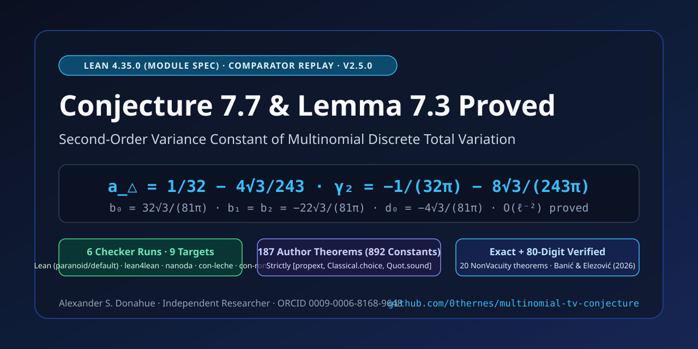

# Proof of Conjecture 7.7 on the Second-Order Variance Constant of Multinomial Discrete Total Variation

[](https://github.com/0thernes/multinomial-tv-conjecture/actions/workflows/lean-verify.yml)
[](https://github.com/0thernes/multinomial-tv-conjecture/actions/workflows/ci.yml)
[](https://0thernes.github.io/multinomial-tv-conjecture/blueprint/)
[](LICENSE)
[](LICENSE-DOCS)
[](https://www.repostatus.org/#active)

A **Lean 4.35.0** proof of **Conjecture 7.7 (`conj:atriangle`)** and the complete quantitative $O(L^{-2})$ remainder of **Lemma 7.3** of Nikola Banić and Neven Elezović, *Discrete total variation under the multinomial, Part 2: variance under the uniform null* (`arXiv:2610.17046v1`, posted 2026-10-12). The source is an arXiv v1 preprint with no journal reference; it has not been peer reviewed. Part 5 of the same series (`arXiv:2611.14735v1`, Remark 3.11) still lists the closed form as unproved. The repository also contains independent exact-rational and 80-digit Python checks, a Lean 4 Blueprint, an isolated source-code mutation audit, and an AMS-LaTeX manuscript.

Lean also checks five algebraic identities: the result of inserting the proved constants into the Banić–Elezović formulas for $\gamma(n)$, $\gamma(3; N)$ (both rearranged and in the literal Part 2 §7.2 source form `2 p_1(3) + 2 [b_{N mod 3} - 7/(96π)]`), $\gamma(4; N)$ (Part 2, Theorem 7.6, §7.2, and §8), and $\gamma_c(n)$ (Part 5, Theorem 3.10). Lean defines no random variable or variance. That these expressions are the $N^{-2}$ variance coefficients is the content of those cited theorems, which are not formalized here.

The 10 target theorems of `Challenge.lean` and the declarations they depend on are replayed in CI by `lake comparator --paranoid`, which makes **six checker runs**: the Lean kernel in paranoid and in default mode, `lean4lean`, `nanoda`, `con-leche`, and `con-ron` (two of the six runs are the Lean kernel). Separately, `NonVacuity.lean` is independently replayed in CI via `lake env leanchecker MultinomialTVConjecture.NonVacuity`.

**Author:** Alexander Stephen Donahue · Independent Researcher, Spokane, WA, USA · ORCID [0009-0006-8168-9648](https://orcid.org/0009-0006-8168-9648) · `0_0@0thernes.art`
**Status:** Active research preprint (`v2.6.0`, 2026-11-26) — **NOT externally peer reviewed**, and the source conjecture is itself from an unrefereed arXiv v1 preprint; independent human line-by-line statement-fidelity audit and external operator replication remain open (see [docs/statement-fidelity.md](docs/statement-fidelity.md), [REPLICATION.md](REPLICATION.md), and [LIMITATIONS.md](LIMITATIONS.md)). All corrections from the 2026-11-26 statement audit and subsequent hardening rounds are logged in [ERRATA.md](ERRATA.md).



*(Regenerable from current code & logs via `python3 scripts/generate_social_preview.py`.)*

---

## Main Theorem (Conjecture 7.7 & Quantitative Lemma 7.3 Proved)

For $(X_1, X_2, X_3) \sim \mathrm{Mult}(L; \tfrac{1}{3}, \tfrac{1}{3}, \tfrac{1}{3})$, define the adjacent pair expectation $h_{\mathrm{adj}}(L) := \mathbb{E}[|X_2 - X_1|\,|X_3 - X_2|]$, $c_L := \frac{2\sqrt{3}}{3\pi} + \frac{1}{9}$, and $a_* := -\frac{2\sqrt{3}}{9\pi}$. For each residue class $r \in \{0, 1, 2\}$, the $1/L$-order limit
$$b_r := \lim_{\substack{L \to \infty \\ L \equiv r \pmod{3}}} L\bigl(h_{\mathrm{adj}}(L) - c_L L - a_*\bigr)$$
exists and equals:

$$b_0 = \frac{32\sqrt{3}}{81\pi}, \qquad b_1 = b_2 = -\frac{22\sqrt{3}}{81\pi}, \qquad d_0 = \frac{b_0 + b_1 + b_2}{3} = -\frac{4\sqrt{3}}{81\pi},$$

$$b_r = d_0 + \frac{4\sqrt{3}}{9\pi}\cos\!\left(\frac{2\pi r}{3}\right) \quad (r \in \{0, 1, 2\}),$$

$$a_\triangle = \frac{1}{32} + \frac{\pi}{9}(b_0 + b_1 + b_2) = \frac{1}{32} - \frac{4\sqrt{3}}{243}, \qquad \gamma_2 = \frac{64 a_\triangle - 3}{32\pi} = -\frac{1}{32\pi} - \frac{8\sqrt{3}}{243\pi},$$

together with the quantitative Lemma 7.3 remainder bound $\exists C \ge 0,\;\forall L \ge 1,\;|h_{\mathrm{adj}}(L) - c_L L - a_* - b_{L\bmod 3}/L| \le C/L^2$ (`lemma_7_3_O_inv_sq`).

This removes the sole conjectural input from the Banić–Elezović formulas below. Assuming Theorem 7.6 of Part 2 (`arXiv:2610.17046v1`) and Theorem 3.10 of Part 5 (`arXiv:2611.14735v1`), which are cited and not formalized here, inserting $a_\triangle$ gives the following $N^{-2}$ variance coefficients for $n \ge 5$. Lean checks only the algebra of this substitution, for real $n \ne 0$:
$$\gamma(n) = -\frac{n(n+1)}{32\pi} - \frac{8\sqrt{3}\,n(n-2)}{243\pi} + \frac{n-1}{8\pi n}, \qquad \gamma_c(n) = -\frac{n(n+4)}{32\pi} - \frac{8\sqrt{3}\,n^2}{243\pi}.$$

---

## Axiom Audit (Excerpt of `#print axioms` Output)

The Lean sources contain **189 author-written theorems and lemmas**. `Lean.collectAxioms` in [lean/VerifyAxioms.lean](lean/VerifyAxioms.lean) checks all **894 theorem constants** the compiler emits for them (189 author-written + 705 compiler-generated auxiliaries) across all 10 `module`-header Lean 4.35.0 files (`autoImplicit = false`, `weak.linter.mathlibStandardSet = true`). Every one depends only on Lean's three standard axioms `[propext, Classical.choice, Quot.sound]`. There is **no `sorry`**, **no `admit`**, **no custom `axiom`**, **no `native_decide`**, and **no `unsafe`** in `lean/MultinomialTVConjecture/` or `lean/Solution.lean`.

Excerpt of the output of `cd lean && lake env lean VerifyAxioms.lean`: 25 of the 57 `depends on axioms` lines, and the final summary line (each line shown is checked against `results/lean-axioms-all.log` by `scripts/check_readme_axioms.py --require-exhaustive` in CI):

```text
'MultinomialTV.hAdj_eq_nested_sum' depends on axioms: [propext, Classical.choice, Quot.sound]
'MultinomialTV.hAdj_mod0' depends on axioms: [propext, Classical.choice, Quot.sound]
'MultinomialTV.hAdj_mod1' depends on axioms: [propext, Classical.choice, Quot.sound]
'MultinomialTV.hAdj_mod2' depends on axioms: [propext, Classical.choice, Quot.sound]
'MultinomialTV.tendsto_hAdj_mod0' depends on axioms: [propext, Classical.choice, Quot.sound]
'MultinomialTV.tendsto_hAdj_mod1' depends on axioms: [propext, Classical.choice, Quot.sound]
'MultinomialTV.tendsto_hAdj_mod2' depends on axioms: [propext, Classical.choice, Quot.sound]
'MultinomialTV.lemma_7_3_O_inv_sq' depends on axioms: [propext, Classical.choice, Quot.sound]
'MultinomialTV.conjecture_7_7_aTriangle' depends on axioms: [propext, Classical.choice, Quot.sound]
'MultinomialTV.conjecture_7_7_gamma2' depends on axioms: [propext, Classical.choice, Quot.sound]
'MultinomialTV.conjecture_7_7_d0' depends on axioms: [propext, Classical.choice, Quot.sound]
'MultinomialTV.bRes_cosine_formula' depends on axioms: [propext, Classical.choice, Quot.sound]
'MultinomialTV.conjecture_7_7' depends on axioms: [propext, Classical.choice, Quot.sound]
'MultinomialTV.gamma_closed_form' depends on axioms: [propext, Classical.choice, Quot.sound]
'MultinomialTV.gamma_cyclic_closed_form' depends on axioms: [propext, Classical.choice, Quot.sound]
'MultinomialTV.gamma3_closed_form' depends on axioms: [propext, Classical.choice, Quot.sound]
'MultinomialTV.gamma3_source_form' depends on axioms: [propext, Classical.choice, Quot.sound]
'MultinomialTV.gamma4_closed_form' depends on axioms: [propext, Classical.choice, Quot.sound]
'MultinomialTV.ComparatorTarget.target_conjecture_7_7' depends on axioms: [propext, Classical.choice, Quot.sound]
'MultinomialTV.ComparatorTarget.target_gamma_closed_form' depends on axioms: [propext, Classical.choice, Quot.sound]
'MultinomialTV.ComparatorTarget.target_gamma_cyclic_closed_form' depends on axioms: [propext,
 Classical.choice,
 Quot.sound]
'MultinomialTV.ComparatorTarget.target_gamma3_closed_form' depends on axioms: [propext, Classical.choice, Quot.sound]
'MultinomialTV.ComparatorTarget.target_gamma4_closed_form' depends on axioms: [propext, Classical.choice, Quot.sound]
'MultinomialTV.ComparatorTarget.target_lemma_7_3_O_inv_sq' depends on axioms: [propext, Classical.choice, Quot.sound]
'MultinomialTV.ComparatorTarget.target_gamma3_source_form' depends on axioms: [propext, Classical.choice, Quot.sound]
ALL_THEOREMS_AXIOM_AUDIT_PASS: checked 894 theorems across MultinomialTV — 0 disallowed axioms.
```

---

## Comparator Check and Non-Vacuity Witnesses

To separate statement auditing from proof internals, every Lean file carries a Lean 4.35.0 `module` header (Palomar Registry spec), and [lean/Challenge.lean](lean/Challenge.lean) (164 lines) imports **only Mathlib** (zero files from our proof library) and states the 10 targets: the three residue-class limits and Conjecture 7.7 (targets 1–4), the five algebraic identities behind Corollary 1.2(i)–(iii) (targets 5–8 and 10, with target 10 stating the literal Part 2 §7.2 `n = 3` source expression and proving its equivalence `q_1(3) - d_0 = -7/(96π)` with target 7, and target 8 carrying `(-1)^N/(2π)` unchanged on both sides), and the quantitative $O(L^{-2})$ Lemma 7.3 remainder bound (target 9). [lean/Solution.lean](lean/Solution.lean) proves those declarations without `sorry`, and `lake comparator --config comparator.json --paranoid` replays the 10 targets and the declarations they depend on in **six checker runs** (the Lean kernel in paranoid and default mode, `lean4lean`, `nanoda`, `con-leche`, `con-ron`). Separately, `NonVacuity.lean` is independently replayed in CI via `lake env leanchecker MultinomialTVConjecture.NonVacuity`, and the false value $a_\triangle = 1/32$ is refuted by the proved theorem `adversarial_aTriangle_ne_one_div_32`.

| Verification Check | Tool / File | Scope |
|---|---|---|
| **Lean kernel** | `lean 4.35.0` / `lake build` (`module` headers) | 189 author-written theorems and lemmas (894 theorem constants) across `MultinomialTVConjecture`, `Solution`, `VerifyAxioms`; no warnings except the 10 intentional `sorry` warnings of the statement-only `Challenge.lean` |
| **Comparator checker runs** | `lake comparator --config comparator.json --paranoid` (Lean kernel in paranoid and default mode, `lean4lean`, `nanoda 0.4.19`, `con-leche`, `con-ron`) | All 10 targets (incl. `target_lemma_7_3_O_inv_sq` & literal §7.2 `target_gamma3_source_form`) and their dependencies (`Challenge.lean` vs. `Solution.lean`) |
| **Standalone `NonVacuity` replay** | `lake env leanchecker MultinomialTVConjecture.NonVacuity` | Independent kernel replay of all 20 theorems in `NonVacuity.lean` (6 direct `hAdj 0..5` definition checks + 14 sign, witness, and false-constant refutation corollaries including `adversarial_aTriangle_ne_one_div_32`) |
| **Exhaustive axiom audit** | `lean/VerifyAxioms.lean` (`Lean.collectAxioms`) | 894/894 theorem constants (189 author-written, 705 compiler-generated) within `[propext, Classical.choice, Quot.sound]` |
| **Batteries & Mathlib linters** | `lake exe runLinter MultinomialTVConjecture` & `weak.linter.mathlibStandardSet = true` | 0 warnings across Batteries + Mathlib style linters (`autoImplicit = false`) |
| **Exact rational, differential & code-mutation audit** | `scripts/verify_conjecture.py`, `scripts/run_mutation_audit.py` & `tests/` | Exact `Fraction` ($L=3..45$, 0/1 error); 3,000+ Hypothesis cases; 1,140-input differential oracle; 22/22 isolated code mutants killed; 28-pt Richardson error $< 3 \times 10^{-55}$ (>54 digits) |

See [docs/statement-fidelity.md](docs/statement-fidelity.md) for the declaration-by-declaration mapping to Banić & Elezović (`arXiv:2610.17046v1`), and [CLAIMS.md](CLAIMS.md) for explicit falsification criteria ("What Would Prove Us Wrong").

---

## Quickstart

Verify the formal proof and independent numerical checks from a clean clone:

```bash
git clone https://github.com/0thernes/multinomial-tv-conjecture.git
cd multinomial-tv-conjecture

# 1. Install pinned Python verification & test dependencies
python3 -m pip install -r requirements.txt

# 2. Fetch pinned Mathlib cache, build Lean 4.35.0 proofs, audit axioms & run the comparator (six checker runs)
cd lean
lake exe cache get
lake build MultinomialTVConjecture Challenge Solution VerifyAxioms
lake env lean VerifyAxioms.lean
lake comparator --config comparator.json --paranoid   # Linux with bubblewrap
cd ..

# 3. Run independent exact rational + 80-digit checks, pytest ladder, citations, Blueprint & repo audit
python3 scripts/verify_conjecture.py
python3 -m pytest -v tests/
python3 scripts/check_citations.py
python3 scripts/check_readme_axioms.py --require-exhaustive
python3 scripts/build_blueprint.py
python3 scripts/build_site.py
```

Full step-by-step instructions for Linux, macOS, and Windows appear in [REPLICATION.md](REPLICATION.md).

---

## Usage

Common one-word workflows via `just` (see [justfile](justfile) and [scripts/dev.sh](scripts/dev.sh)):

```bash
just verify-lean     # Build Lean, scan forbidden tokens, run VerifyAxioms + comparator (Linux)
just verify-numeric  # Run exact rational (L=3..45) and 80-digit mpmath checks
just test            # Run full pytest ladder (exact, Hypothesis, negative, regression, golden, mutation, stability)
just blueprint       # Validate every \lean{...} tag and build interactive SVG dependency Blueprint
just paper           # Compile AMS-LaTeX preprint via Tectonic & build byte-reproducible arXiv bundle
just reproduce       # End-to-end clean reproduction & Build Standard v1.2.0 audit
just audit           # Score repository against Build Standard v1.2.0 (90 items)
```

---

## Repository Structure

| Path | Description |
|---|---|
| `lean/MultinomialTVConjecture/` | Core Lean 4.35.0 proof (`Combinatorial`, `StirlingRefined`, `GaussianEulerMaclaurin`, `LocalAsymptotics`, `Main`, `NonVacuity`) |
| `lean/Challenge.lean`, `Solution.lean`, `comparator.json` | Isolated Mathlib-only target statements (10 targets) & comparator bridge |
| `lean/VerifyAxioms.lean` | Exhaustive `Lean.collectAxioms` metaprogram (894 constants) + 57 explicit `#print axioms` checks |
| `paper/main.tex`, `paper/refs.bib`, `paper/figures/` | AMS-LaTeX manuscript source (`v2.6.0`), verified BibTeX with clickable DOIs, and publication figures |
| `dist/` | Compiled PDF (`Donahue_2026_Conjecture_7_7_Multinomial_TV.pdf`) and byte-reproducible `arxiv_submission.tar.gz` |
| `blueprint/src/content.tex` | Lean 4 dependency Blueprint validated against `lean/` by `scripts/build_blueprint.py` |
| `scripts/` | Independent numerical verifier, isolated code mutation runner (`run_mutation_audit.py`), SVG preview generator (`generate_social_preview.py`), arXiv bundler, dual timestamp stamper, axiom/citation/Blueprint/site/manifest/Build Standard scripts |
| `tests/` | Automated `pytest` + `hypothesis` test ladder |
| `docs/` | Architecture, statement-fidelity table, verification stack, literature search, ADRs, threat model, operations, FAQ, glossary, red-team review |
| `results/`, `data/MANIFEST.sha256*` | Live axiom/comparator/linter/citation/mutation logs, 31-file SHA-256 manifest, DigiCert RFC 3161 `.tsr`, and Bitcoin OpenTimestamps `.ots` |

---

## Maintenance Status & Accessibility

**Status: Active** (repostatus: `active`). The Lean proof of Conjecture 7.7 and the quantitative $O(L^{-2})$ Lemma 7.3 remainder builds and passes all six comparator checker runs on tag `v2.5.0` (commit `ad699d8`): Ubuntu 24.04 comparator CI run [`45942992816`](https://github.com/0thernes/multinomial-tv-conjecture/actions/runs/45942992816) (Sigstore Rekor [`4141986348`](https://search.sigstore.dev?logIndex=4141986348) / attestation `72947181`), Release `v2.5.0` run [`45942993056`](https://github.com/0thernes/multinomial-tv-conjecture/actions/runs/45942993056) (Rekor [`4141888347`](https://search.sigstore.dev?logIndex=4141888347) / attestation `72946156`, verified live via `gh attestation verify`), DigiCert RFC 3161 timestamp [`data/MANIFEST.sha256.tsr`](data/MANIFEST.sha256.tsr), and Bitcoin OpenTimestamps [`data/MANIFEST.sha256.ots`](data/MANIFEST.sha256.ots). The committed `results/comparator-paranoid.log` is the verbatim 9-target output of CI run `45942992816`. Maintenance covers toolchain updates if requested, recording external human statement-fidelity audits in [docs/statement-fidelity.md](docs/statement-fidelity.md) and clean-room replications in [REPLICATION.md](REPLICATION.md), and logging any errata in [ERRATA.md](ERRATA.md).

**Accessibility & Internationalization (`A38`):** User-facing prose, documentation, and LaTeX are authored in UTF-8 English (`en-US`) with ISO 8601 dates (`YYYY-MM-DD`). Both the static portal (`https://0thernes.github.io/multinomial-tv-conjecture/`) and interactive Lean Blueprint (`blueprint/`) implement semantic HTML5 landmarks, keyboard skip-to-content links, `:focus-visible` focus rings, `aria-pressed` / `aria-live="polite"` status readouts, WCAG AA contrast, and `prefers-reduced-motion` support.

## Citation & Licensing

- **Code, Lean 4 proofs, scripts, and tests:** [Apache License 2.0](LICENSE) (`SPDX-License-Identifier: Apache-2.0`).
- **Manuscript, figures, Blueprint, and documentation:** [CC BY 4.0](LICENSE-DOCS) (`SPDX-License-Identifier: CC-BY-4.0`).
- **Attribution & third-party notices:** See [NOTICE](NOTICE), [THIRD_PARTY_NOTICES.md](THIRD_PARTY_NOTICES.md), [CITATION.cff](CITATION.cff), and [formalization.yaml](formalization.yaml).
