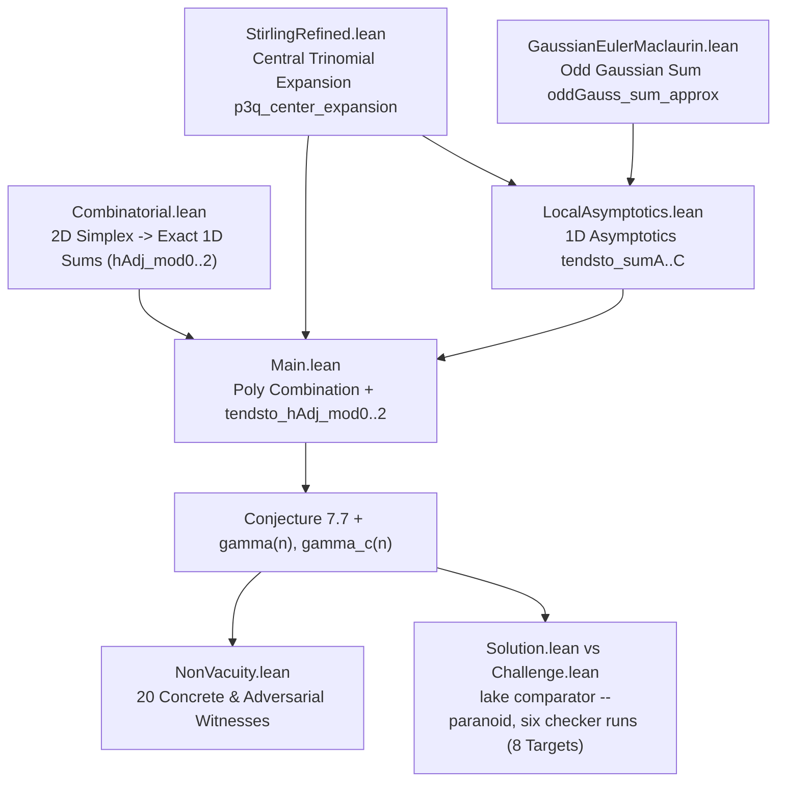

# Proof & Verification Architecture (`docs/architecture.md`)

## Mathematical Proof Pipeline

The Lean 4 formalization proves Conjecture 7.7 of Banić & Elezović (`arXiv:2610.17046v1`, an unrefereed arXiv preprint) through a five-stage reduction that replaces an intractable 2D triangular-lattice asymptotic expansion with three elementary 1D sums:

## Module Breakdown

| Module | Role | Key Exports |
|---|---|---|
| `lean/MultinomialTVConjecture/Combinatorial.lean` | Exact simplex summation and algebraic identities eliminating the 2D sum | `hAdj`, `p3q`, `sumA`, `sumB`, `sumC`, `hAdj_mod0`, `hAdj_mod1`, `hAdj_mod2` |
| `lean/MultinomialTVConjecture/StirlingRefined.lean` | Quantitative Robbins-type Stirling remainder with $O(q^{-3})$ control | `p3q_center_expansion` |
| `lean/MultinomialTVConjecture/GaussianEulerMaclaurin.lean` | Euler–Maclaurin approximation of the odd-lattice Gaussian sum | `oddGauss_sum_approx` |
| `lean/MultinomialTVConjecture/LocalAsymptotics.lean` | Local Gaussian/Laplace asymptotics for the three 1D residual sums | `tendsto_sumA`, `tendsto_sumB`, `tendsto_sumC` |
| `lean/MultinomialTVConjecture/Main.lean` | Exact nested-sum equivalence, residue limits `b_0, b_1, b_2`, Conjecture 7.7, and linear/cyclic/small-bin `γ` formulas | `hAdj_eq_nested_sum`, `tendsto_hAdj_mod0..2`, `conjecture_7_7`, `gamma_closed_form`, `gamma_cyclic_closed_form`, `gamma3_closed_form`, `gamma4_closed_form` |
| `lean/MultinomialTVConjecture/NonVacuity.lean` | Concrete exact rational evaluations `hAdj 0..5`, strict sign bounds, 3 false-constant refutations, `n ∈ {3,4,5}` witnesses | `hAdj_zero..five`, `adversarial_*`, `gamma*_witness_*` |
| `lean/Challenge.lean` | 100% Mathlib-only target statements (8 intentional `sorry` stubs, zero proof-library imports) | `MultinomialTV.ComparatorTarget.target_*` |
| `lean/Solution.lean` | Sorry-free bridge proving `Challenge.lean` targets via `MultinomialTVConjecture.Main` | Same 8 declarations, replayed by six comparator checker runs |
| `lean/VerifyAxioms.lean` | Exhaustive `Lean.collectAxioms` metaprogram + 49 explicit `#print axioms` checks | Emits `ALL_THEOREMS_AXIOM_AUDIT_PASS` |

## Independent Verification Layer

- **`scripts/verify_conjecture.py`**: Completely independent Python implementation computing exact rational `Fraction` values for $L=3..45$ (0/1 error) and 80-digit `mpmath` evaluations up to $q=3{,}000$ ($L=9{,}001$) with 28-point Neville–Richardson extrapolation matching all 6 constants to $>54$ decimal digits ($<3\times 10^{-55}$).
- **`tests/`**: Automated `pytest` + `hypothesis` ladder testing exact identities, negative/adversarial bounds, regressions, golden snapshots, differential/oracle checks, metamorphic invariants, multi-precision stability, mutant rejection, and repository metadata integrity.
- **`blueprint/` & `scripts/build_blueprint.py`**: Validates every `\lean{...}` tag in `blueprint/src/content.tex` against actual Lean declarations and emits a static SVG DAG + HTML page at `build/site/blueprint/`.
